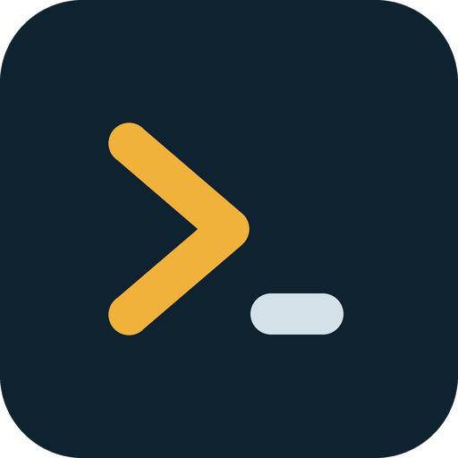
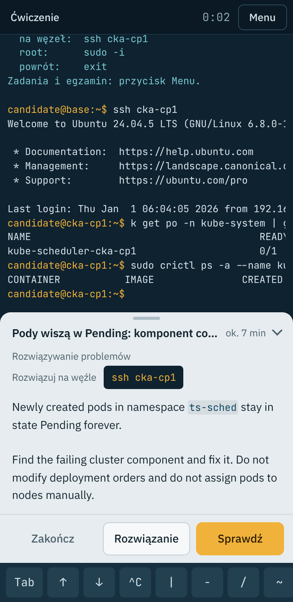
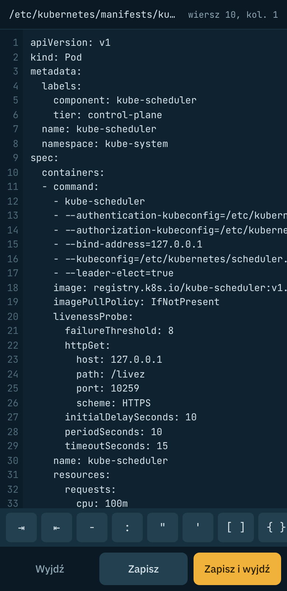
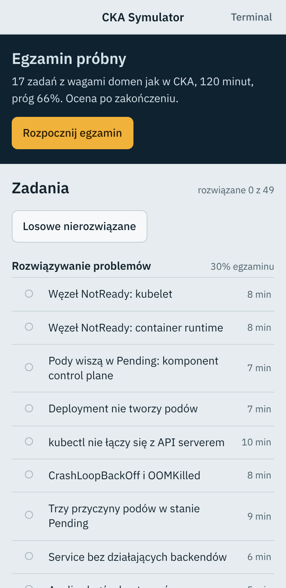

<p align="center"></p>

# CKA Symulator

Aplikacja na Androida do nauki do egzaminu **Certified Kubernetes Administrator**. Cały klaster Kubernetes jest symulowany w telefonie – działa offline, bez serwerów i bez internetu.

- klaster kubeadm v1.37: `cka-cp1` (control plane), `cka-w1`, `cka-w2`, Calico, containerd, CoreDNS, metrics-server, ingress-nginx, NGINX Gateway Fabric, local-path
- terminal jak na egzaminie: startujesz na stacji `base`, na węzły przechodzisz przez `ssh`, roota dostajesz przez `sudo -i`
- `kubectl` z realistycznymi komunikatami i formatami wyjścia (tabele, `describe`, `-o yaml/json/jsonpath/custom-columns`, `edit`, `apply`, `diff`, `rollout`, `drain`, kustomize…), a także `crictl`, `systemctl`, `journalctl`, `kubeadm`, `etcdctl`/`etcdutl`, `openssl`, `helm`, `apt`, `curl`, `nslookup` i typowe narzędzia powłoki (pipe’y, heredoc, pętle, `grep`, `sed`, `awk`, `jq`, `yq`…)
- 49 zadań w pięciu domenach CKA, część z kilkoma losowanymi wariantami awarii; każde ma automatyczne sprawdzanie i przykładowe rozwiązanie
- egzamin próbny: 17 zadań, 120 minut, wagi domen jak w CKA, próg 66%, wynik z podziałem na domeny

Zadania są autorskie – to nie są pytania z egzaminu ani z „dumpów”.

| Zadanie | Edytor | Menu |
|---|---|---|
|  |  |  |

## Instalacja

1. Wejdź w zakładkę **Releases** tego repozytorium i otwórz najnowsze wydanie.
2. Pobierz plik `cka-symulator.apk` na telefon i otwórz go.
3. Android zapyta o zgodę na instalację z tego źródła (przeglądarki lub menedżera plików) – zezwól.

Każdy push do gałęzi `main` buduje nowe APK (GitHub Actions). Kolejne wersje instalują się na poprzednich bez utraty postępów, bo wszystkie są podpisane tym samym kluczem. Wymagany Android 7.0 lub nowszy. Aplikacja nie prosi o żadne uprawnienia.

## Jak korzystać

- **Menu** (prawy górny róg): lista zadań według domen, egzamin próbny, ustawienia.
- Po wybraniu zadania na dole ekranu pojawia się jego treść. Stuknij nazwę, ścieżkę lub wartość w treści, aby wstawić ją do linii poleceń. Przycisk z poleceniem `ssh …` wstawia przejście na właściwy węzeł.
- **Sprawdź** ocenia rozwiązanie i pokazuje, które kryteria są spełnione. **Rozwiązanie** pokazuje przykładowy sposób (z komentarzami po polsku). **Zakończ** sprząta po zadaniu.
- Rząd klawiszy nad klawiaturą: `Tab` (uzupełnianie poleceń, ścieżek i nazw zasobów – dwa razy Tab pokazuje listę), historia ↑ ↓, `^C`, znaki trudno dostępne na klawiaturze telefonu i gotowe fragmenty (`k`, `-n`, `-o yaml`, `--dry-run=client -o yaml`).
- `vim`, `nano` i `kubectl edit` otwierają edytor z numerami wierszy, automatycznym wcięciem YAML, wyszukiwaniem i przyciskami zapisu.
- Wklejenie kilku linii naraz wykonuje je po kolei – działa też z heredoc (`cat <<EOF | kubectl apply -f -`).
- Czas w klastrze płynie normalnie; w ustawieniach można go przyspieszyć (2×, 5×, 10×). Stan klastra i postęp zapisują się automatycznie. **Przywróć świeży klaster** cofa wszystkie zmiany.
- Egzamin próbny zaczyna od świeżego klastra. Wynik widać dopiero po zakończeniu – tak jak na prawdziwym egzaminie.

## Ograniczenia

To symulator, nie prawdziwy Kubernetes. Odtwarza zachowanie kontrolerów, schedulera, kubeleta, sieci (Service, DNS, NetworkPolicy, Ingress, Gateway API), RBAC, certyfikatów i etcd na tyle, żeby ćwiczyć zadania typowe dla CKA, ale nie obsługuje każdej opcji każdego polecenia. Jeśli coś zachowuje się inaczej niż w prawdziwym klastrze, zgłoś to jako issue. Przed egzaminem warto też przećwiczyć całość na prawdziwych maszynach.

## Budowanie samodzielnie

```bash
npm ci
npm test                 # testy: każde zadanie i wariant jest rozwiązywane w symulatorze
npm run build            # aplikacja webowa do www/ (z migawką klastra)
npx cap sync android
cd android && ./gradlew assembleDebug   # wymaga JDK 21 i Android SDK
```

Podgląd w przeglądarce: po `npm run build` uruchom dowolny serwer statyczny w katalogu `www/` (np. `python3 -m http.server`) i otwórz go w widoku telefonu.

## Struktura

| Katalog | Zawartość |
|---|---|
| `src/sim` | symulacja klastra: API server, etcd, scheduler, kontrolery, kubelet, sieć, PKI, systemd, hosty |
| `src/kubectl` | implementacja `kubectl` |
| `src/shell` | powłoka (parser i interpreter podzbioru basha) i polecenia systemowe |
| `src/tasks` | zadania, sprawdzanie, egzamin próbny |
| `src/app` | interfejs: terminal, edytor, uzupełnianie, treść zadań, wyniki |
| `android` | projekt Capacitor dla Androida |
| `test` | testy uruchamiane lokalnie i w CI |

Licencja MIT. Kubernetes jest znakiem towarowym The Linux Foundation; projekt nie jest z nią powiązany.
